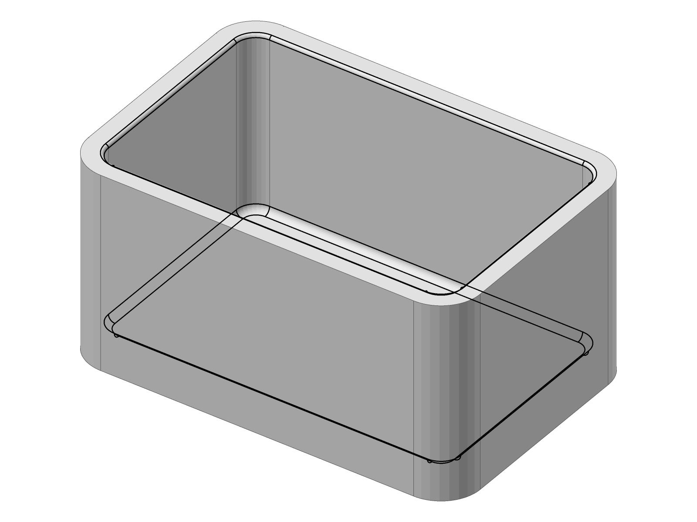

# Mirrored shell-rim review images

Actual diagnostics for tangency-labs/solidcore#2924, all using view 145°, −35°. The operand is what remains when main refuses. Fixed images are the formerly refused corner, not its already-successful mirror. Black tolerance overlays also show hidden floor edges. These are generated geometry renders, not illustrations.

| Operand | Corrected round | Corrected chamfer |
|---|---|---|
|  |  |  |
